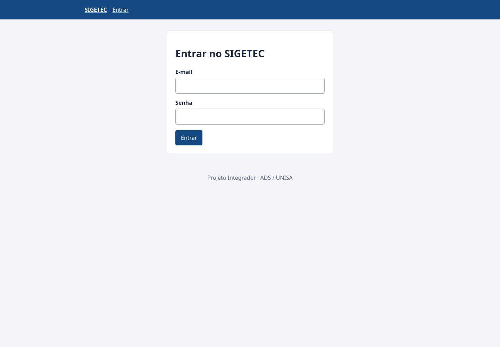
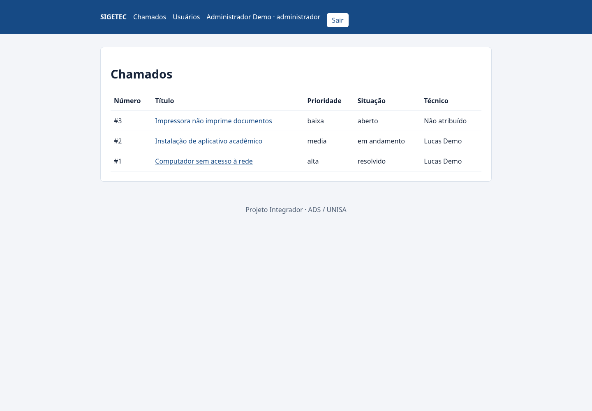
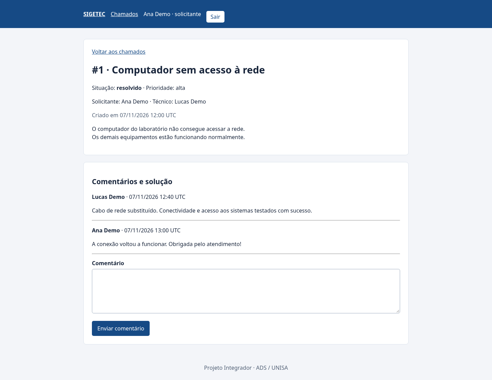

# SIGETEC — Sistema de Gerenciamento de Chamados Técnicos

Projeto independente de **Sistema de Gerenciamento de Chamados Técnicos**.
Aplicação para abrir, atribuir e acompanhar chamados de suporte,
com acesso separado para administrador, técnico e solicitante.

**Novo endereço (migração em andamento; aguarda configuração do banco):** [sigetec-chamados.onrender.com](https://sigetec-chamados.onrender.com)
· **[Entrar](https://sigetec-chamados.onrender.com/login)**
· **[Roteiro de apresentação](docs/apresentacao.md)**
· **[Relatório de entrega e validação](docs/entrega.md)**

O professor pode testar pelo navegador, sem instalar o projeto. Os acessos da
instância online são compartilhados privadamente pelo responsável; não há
senhas publicadas neste repositório.

## Funcionalidades entregues

| Perfil | Acesso |
| --- | --- |
| Solicitante | Abre chamados, visualiza os próprios e registra comentários |
| Técnico | Visualiza os chamados atribuídos a ele, registra solução/comentários e atualiza a situação |
| Administrador | Visualiza todos, atribui técnicos, atualiza a situação, fecha/reabre chamados e cadastra técnicos e solicitantes |

O administrador também ativa/desativa contas sem excluir seus chamados ou
comentários. Contas administrativas são protegidas contra desativação pela tela.
O cadastro público e a criação de administradores pelo formulário não existem.
Somente o administrador pode reabrir um chamado fechado.

Prioridades: `baixa`, `media`, `alta`, `critica`.
Situações: `aberto`, `em_andamento`, `resolvido`, `fechado`.
As permissões são verificadas no servidor, inclusive em acessos diretos por URL.

O escopo permanece simples: não há anexos, notificações por e-mail, relatórios,
categorias, auditoria separada, edição de perfil ou troca de senha pela interface.
Comentários permitem registrar o atendimento e a solução.

## Três capturas do sistema funcionando

Capturas reais em Chromium, feitas em **7/11/2026** com o código da aplicação,
SQLite temporário e dados totalmente fictícios. Não foram usadas contas do PostgreSQL hospedado. A interface é a mesma da
versão publicada.
Nenhuma senha foi incluída nas imagens.

**1. Autenticação**



**2. Chamados na visão do administrador**



**3. Atendimento e solução na visão do solicitante**



O script opcional de reprodução é `scripts/capturar_telas.py`; instruções no
[roteiro de apresentação](docs/apresentacao.md#reproduzir-as-capturas-opcional).
Playwright não é uma dependência necessária para executar o SIGETEC.

## Executar localmente, sem Docker ou PostgreSQL

Requisito: **Python 3.11 ou superior**, pip e venv. A instalação das bibliotecas
precisa de internet. Depois, a execução local não depende de serviços externos.
O ambiente validado foi Linux com Python 3.14.7; Windows/macOS não foram testados.

```bash
git clone https://github.com/HelioGHB/ProjetoIntegradorUnisaProgWEB.git
cd ProjetoIntegradorUnisaProgWEB
python -m venv .venv
```

Ative o ambiente:

| Sistema | Comando |
| --- | --- |
| Linux/macOS | `source .venv/bin/activate` |
| Windows PowerShell | `.venv\Scripts\Activate.ps1` |
| Windows Prompt de Comando | `.venv\Scripts\activate.bat` |

Se necessário, use `python3` no Linux/macOS ou `py -3` no Windows para criar o
ambiente. Se o PowerShell bloquear a ativação, use o Prompt de Comando ou
`.venv\Scripts\python.exe` diretamente; não é preciso alterar políticas globais.

```bash
python -m pip install -r requirements.txt
python -m flask --app app preparar-demo
python app.py
```

O comando `preparar-demo` cria as tabelas do SQLite local e solicita uma senha
oculta de **12 a 128 caracteres**, com confirmação. Para facilitar a avaliação
local, as três contas fictícias usam essa senha escolhida:

| E-mail local | Perfil |
| --- | --- |
| admin@example.com | Administrador |
| tecnico@example.com | Técnico |
| solicitante@example.com | Solicitante |

**Não há senha padrão no código.** Esse quadro se refere à demonstração local,
não aos acessos da hospedagem. O comando recusa modificar contas se já houver
usuários. Não o execute no banco online já preparado para criar novas contas:
use **Usuários → Cadastrar usuário**, autenticado como administrador.

Abra **http://127.0.0.1:5000/**. Pare com `Ctrl+C`. Nas próximas execuções,
basta ativar o ambiente e executar `python app.py`.
O banco local fica em `instance/sigetec.sqlite3`; não apague esse arquivo se
quiser preservar os dados. Recebeu um ZIP? Extraia e abra o terminal na pasta
que contém `app.py`, seguindo os mesmos passos sem o clone.

## Roteiro rápido de teste

1. Entre como solicitante e abra um chamado com título, descrição e prioridade.
2. Saia e entre como administrador para atribuir um técnico.
3. Entre como esse técnico, atualize para **em andamento**, comente a solução e
   marque como **resolvido**.
4. Volte ao solicitante para consultar e responder ao atendimento.
5. Confira que solicitante/técnico não acessam `/usuarios`; o administrador
   pode cadastrar novos usuários, fechar o chamado e reabri-lo.

Use **Sair** entre os perfis, ou perfis de navegador separados. Janelas anônimas
do mesmo navegador podem compartilhar a mesma sessão.
O [roteiro completo](docs/apresentacao.md) inclui falas sugeridas e perguntas
para a apresentação acadêmica.

## Tecnologias e estrutura

Python, Flask, Flask-SQLAlchemy, Flask-Login, Flask-WTF/WTForms, Werkzeug,
HTML/CSS, pytest, SQLite local e PostgreSQL com Psycopg 3 na hospedagem.
O Render executa o Flask com Gunicorn. Docker não é necessário.

```text
app.py                       Entrada do servidor local
config.py                    SQLite local e variáveis de produção
sigetec/
    __init__.py              Fábrica create_app, extensões e erros
    models.py                Usuario, Chamado e Comentario
    forms.py                 Formulários e validação
    routes.py                Autenticação, usuários, chamados e permissões
    cli.py                   Comandos de preparação
    bootstrap.py             Inicialização opcional, transacional e repetível
templates/                   Interface HTML e CSS local
scripts/capturar_telas.py     Capturas opcionais em banco temporário
tests/                       Testes isolados
docs/
    apresentacao.md          Roteiro de 8–10 minutos
    entrega.md               Estado entregue, evidências e limites
    fases.md                 Histórico das entregas e commits
    modelagem.md             Tabelas e integridade
    implantacao.md           Operação e hospedagem
    inicializacao-render.md  Referência para inicialização sem Shell
    images/                  Três screenshots usados neste README
requirements.txt             Execução local
requirements-render.txt      PostgreSQL e Gunicorn
requirements-dev.txt         Dependências dos testes
render.yaml                  Referência de configuração do Render
```

`create_app()` monta a aplicação e permite configurar um banco diferente nos
testes. Os modelos representam tabelas; `commit()` confirma uma transação e
`rollback()` desfaz uma transação que falhou. A senha é armazenada como hash com
salt, e as sessões e formulários usam assinatura/CSRF. Detalhes em
[modelagem do banco](docs/modelagem.md).

## Configuração e inicialização

- **Local:** SQLite por padrão, sem `.env` obrigatório. A fábrica lê opcionalmente
  `.env.local`. Sem `SECRET_KEY`, gera uma chave aleatória por inicialização;
  reiniciar encerra sessões antigas, mas não apaga usuários ou chamados.
- **Produção:** exige `APP_ENV=production`, `DATABASE_URL` PostgreSQL com TLS,
  `SECRET_KEY` privada e domínio permitido. O domínio padrão é detectado no
  Render; domínios próprios usam `TRUSTED_HOSTS`.
- O `.env` legado foi preservado. Mesmo se a CLI do Flask o carregar, no modo
  local `DATABASE_URL` é ignorada. Não use `APP_ENV=production` para o teste
  local do professor.
- `init-db` cria tabelas apenas num banco vazio; recusa nomes de tabelas/colunas
  incompatíveis. Não é uma ferramenta de migração e não atualiza esquemas antigos.
- `criar-admin` cadastra o primeiro administrador com senha oculta, sem alterar
  um administrador existente. `preparar-demo` é a alternativa de demonstração.
- O Start Command do Render inclui `inicializar-deploy`, controlado por
  `INIT_DB_ON_START` e `CREATE_ADMIN_ON_START`. Depois do primeiro sucesso,
  mantenha as duas flags em `false` e os valores `BOOTSTRAP_ADMIN_*` vazios ou
  removidos. Não repita a preparação no banco já validado.

A instância online já foi inicializada. O [guia sem Shell](docs/inicializacao-render.md)
é uma referência para instalação nova ou recuperação planejada, não uma
pendência para o professor. Nunca publique credenciais, banco, `.env` ou `.venv`.

## Validação atual

```bash
python -m pip install -r requirements-dev.txt
python -m pytest -q
python -m pip check
```

Em **7/11/2026**, os **69 testes passaram** em SQLite em memória, com CSRF e
chaves estrangeiras habilitados. Cobrem autenticação, integridade, bootstrap,
perfis, usuários, privacidade e o ciclo de atendimento.
Também houve verificação anterior de transações, rollback e concorrência em
PostgreSQL temporário isolado. A captura em navegador percorreu login e páginas
autenticadas numa instância temporária com dados fictícios.

No Render, a fase funcional `bbb5549` foi confirmada **Live**, e `/healthz` e
`/login` responderam HTTP 200. O responsável relatou sucesso no teste completo
online com as contas cadastradas; essa validação manual está distinguida dos
testes automatizados. As capturas não modificam o PostgreSQL hospedado.

## Entrega, GitHub e hospedagem

O código e o histórico estão na branch `main`. Cada fase foi registrada com
mudança e validação em [docs/fases.md](docs/fases.md).
A fonte de verdade do comportamento entregue é o código desta branch.

O Blueprint usa Auto-Deploy Off como referência para novos serviços. No serviço
existente, o Render indicou automático por commit, mas a fase 4 precisou de
deploy manual; confirme os eventos, não apenas o campo de configuração.
Não crie outro serviço ou banco para reproduzir a demonstração já publicada.

Veja [operação no Render](docs/implantacao.md) e o
[relatório de entrega](docs/entrega.md). Planos pagos, operações destrutivas e
novas funcionalidades exigem decisão explícita. Nada depende de GitHub Pages.
O ZIP local em `entrega/SIGETEC.zip` é gerado do commit final e contém código e
documentação, sem banco, credenciais, ambiente virtual ou histórico Git.

---

**O Autor:** Desenvolvido por Greyke Helio - Sinta-se à vontade para se conectar ou dar uma olhada nos meus outros projetos de programação!

Linkedin: [www.linkedin.com/in/helio-ghb](http://www.linkedin.com/in/helio-ghb)
